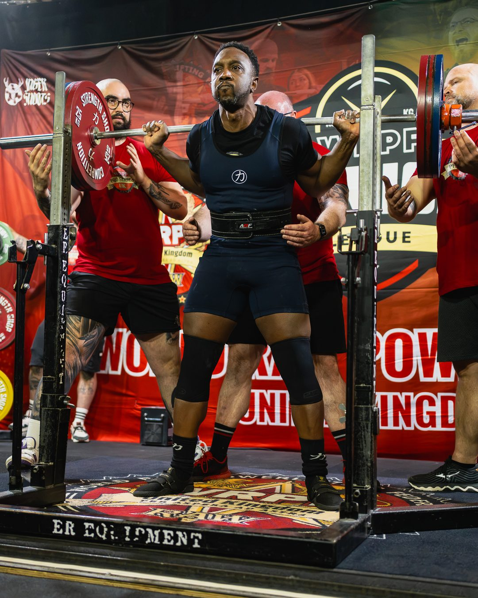
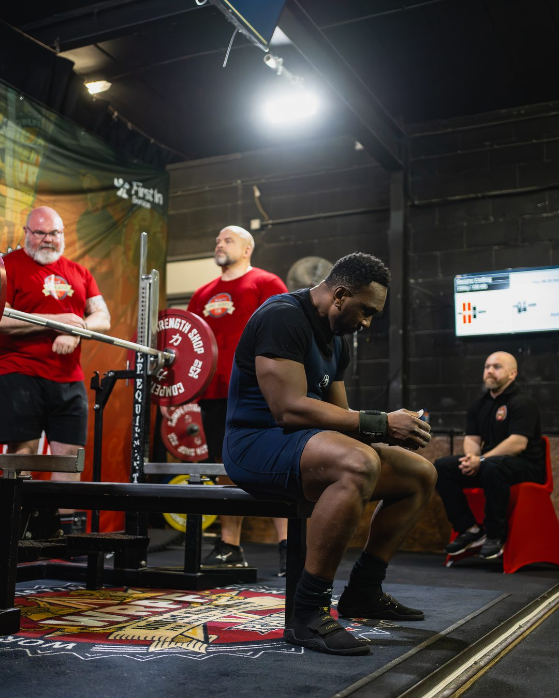
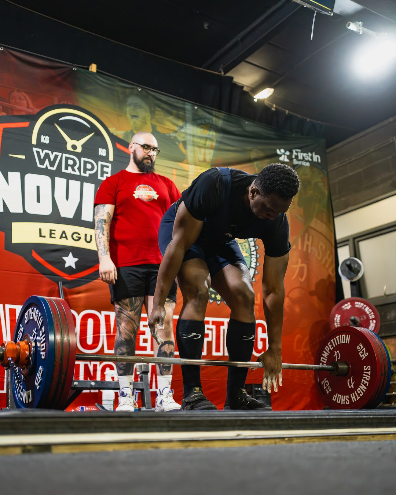
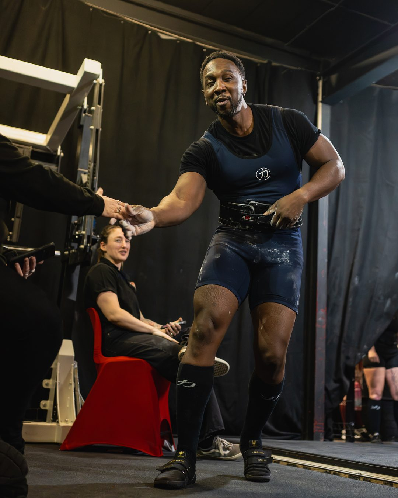

> *Eight weeks before the meet I wasn't sure I'd bench properly again. Coming back stronger was the whole point.*

Eight weeks before Nottingham Strong I was in physio with a rotator cuff injury, not sure I'd bench properly again. On the day I totalled 522.5kg, up 27.5kg from my first meet in March, and placed 7th of 49 overall. I finished second in my Masters 40 to 49 group.

## The numbers

- **Squat:** 150kg in March, 165kg now
- **Bench:** 130kg in March, 130kg now
- **Deadlift:** 215kg in March, 227.5kg now
- **Total:** 495kg in March, 522.5kg now

325.37 Dots at 45.

## How the day went

**Squat: best 165kg**

- 147.5kg: no lift, three reds. Depth was fine, but I walked it back before the rack command.
- 155kg: good lift. New knee sleeves, moved well and stayed still.
- 165kg: good lift. Felt easy. 170 might have been there, but we stuck to the plan to save something for the bench.

**Bench: best 130kg**

- 122.5kg: good lift. A big moment after 8 weeks of physio and shockwave therapy.
- 130kg: no lift. My shoes came off during setup and the bar shifted.
- 130kg: good lift, two whites and one red. Ash wanted me to retake the same weight. I wasn't thrilled at first, but I trusted the plan. The heaviest I've benched in 7 months.

**Deadlift: best 227.5kg**

- 207.5kg: no lift. I paused, the bar bumped my legs and tipped me forward.
- 217.5kg: good lift. Took the slack out and it flew.
- 227.5kg: good lift. Fast off the floor, no hitching. A PB, with more in the tank.

## From my coach

Ash summed it up better than I can in his Instagram post:

> Dwayne's second novice competition was about one thing: proving he could be better than the lifter who stepped on the platform in March. Mission accomplished.
>
> We rebuilt his bench from the bottom, and he still walked away with the heaviest bench of his flight.
>
> That's redemption.

## What I took from it

I finished second in my group behind Dan Tipper, who pulled 255kg. At work I finished second on October's activity board, behind Ruth. Second again.

That's the point, though. When you train, work or compete alongside people who push you, you get better. Finishing behind people who raise the bar beats winning easy every time.

Most of all, I did this for my kids. I wanted them to see that however things go, you can come back stronger.

## Thank you

- **Ash**, for coaching me back from the injury and handling everything on the day.
- **The battle_ash team**: Liz, Becky, Kate, Becky Goodwin, Matt, Dean and Danusha.
- **Clinton**, for the photos and video.
- **[Jager Shoots](https://www.jagershoots.com/)**, for the competition photos in this post.
- **WRPF UK and Nottingham Strong**, for a brilliant event.
- **My family**: Danielle, Janiah, Andre, Dante and Amiyah, the loudest cheerleaders in the room, in the Jamaican colours. 🇯🇲

Next target: a 170kg squat.
