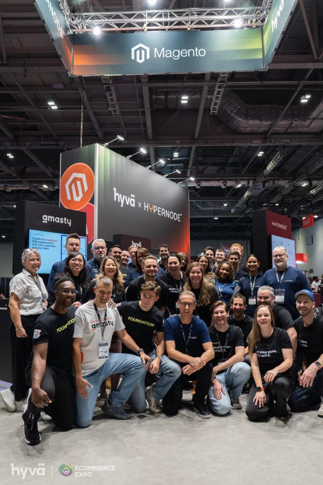

> *Most merchants came looking for expertise. The software mattered less than I expected.*

Two great days on the stand at eCommerce Expo London, and my first ever expo. It was good to get out of my developer bubble and into the big smoke for a bit. I loved being a tourist too, and getting lost with Jade O'Mahony every time we left the hotel. 🤣

I spent most of it with merchants, and had some valuable conversations with the other agencies exhibiting, who face the same daily challenges we do. A few things are worth sharing.

## What merchants told us

**Most merchants came looking for expertise.** The software mattered less than I expected. Nearly everyone I spoke to is running their store with fewer people than last year, and wants help working out how.

People asked for things to be simpler. What they actually want is to not get stuck. The thing that kept coming up was not wanting this year's decision to become next year's problem. That's where Hyvä and a more flexible setup help.

## AI and ownership

AI came up a lot. Everyone wants to be ready for it, but their customers aren't all the same. Some take to it; others need a lot more hand holding. The merchants handling it well look after the customers they already have while going after new ones. To do that, they need a frontend they can change quickly.

**Ownership is behind a lot of the moves, more than cost.** People want to own their stack.

There was so much interest in what we're building as an agency too. Plenty of merchants turned up to the stand already sold on Hyvä, and just wanted to find the right team to build it.

## Thank you

Massive thanks to Ryan Copeland and my team for such a brilliant couple of days. We brought our A game, and I'm really proud I was part of it.

And a big thank you to the teams at Hyvä and Hypernode for organising such a fantastic stand.

If we didn't get the chance to talk on the stand, I'm happy to pick it up. [Get in touch](/contact-me).
